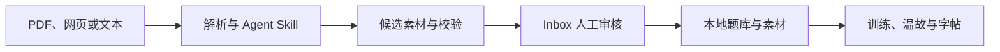

# 申论 AI 智能修炼

一个面向公务员考试申论备考的本地优先应用。把分散的政策材料、真题和课程讲义整理成可审核、可追溯的学习素材，再用于复习、答题和字帖练习。项目通过 Vibe Coding 迭代，主要功能用 Spec Kit 记录规格、实施计划和验收任务。

## 主要功能

| 模块 | 用途 |
| --- | --- |
| 素材工作台 | 导入 PDF、Markdown 或文本，使用 Skill 整理材料、抽取金句、生成练习题或核验来源。 |
| Agent 运行中心 | 使用本机 Codex CLI 或 Claude Code，查看任务计划、流式进度、日志和产物。 |
| Inbox 审核 | 查看候选素材和校验提示，确认后再导入正式本地学习资产。 |
| 申论训练闭环 | 把不同来源的题目统一到标准题库，进行练习、复盘和学习计划安排。 |
| 温故与字帖 | 复习关键词和金句，导出字帖；支持键盘作答和语音输入。 |



## 本地运行

需要 Node.js 22 或以上版本和 pnpm。Windows 上如遇到 PowerShell 脚本执行限制，可以使用 `pnpm.cmd`。

```sh
pnpm install --frozen-lockfile
pnpm dev
```

打开 [素材工作台](http://localhost:3000/materials) 或 [申论训练闭环](http://localhost:3000/practice)。

Windows 桌面端另外需要 Rust、Visual Studio C++ Build Tools 和 WebView2。Agent 任务需要安装并登录所选 CLI。桌面端的 PDF Skill 路径依赖本机安装的 Codex PDF Skill，可在系统设置检查 PDF 和 MinerU OCR 的可用状态。

```sh
pnpm desktop:dev
pnpm desktop:build
```

学习数据保存在本地。调用 CLI 模型或配置云端 OCR、语音服务时，相关输入会按所选服务的配置处理。

## 项目结构

- `app/` 和 `components/`：Next.js、React 和 TypeScript 前端。
- `lib/agent/`：任务编排、上下文预算、运行事件和产物验证。
- `lib/shenlun/`：文档解析、标准题库和训练数据。
- `src-tauri/`：Tauri / Rust 桌面运行时、CLI 适配和语音识别。
- `skills/`：随应用提供的素材工作流。
- `specs/`：[Agent 编排规格](specs/007-ai-agent-orchestrator-cli-v1/spec.md)、[标准题库规格](specs/003-standard-question-bank/spec.md)及其他功能的 SDD 文档。

```sh
pnpm quality
```

第三方项目与模型的出处见 [第三方声明](THIRD_PARTY_NOTICES.md)。
