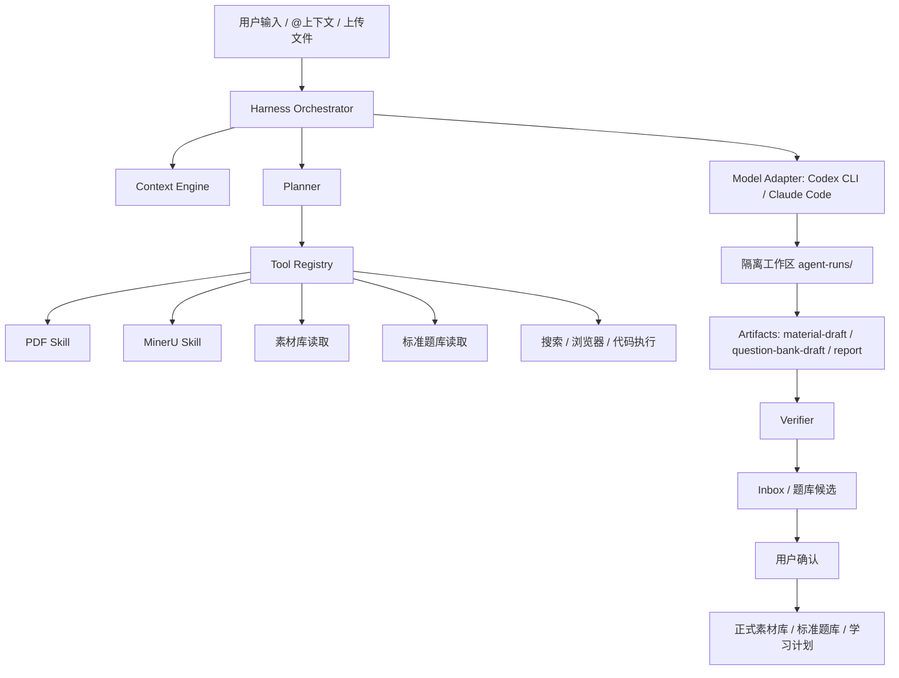

# 申论学习 Agent Harness 需求文档

日期：2026-06-03  
状态：需求设计稿  
范围：素材知识库、Skill Runtime、PDF/网页/文本入库、标准题库、申论训练闭环  
关联实现：
- `types/agent-runtime.ts`
- `lib/agent/chat-runner.ts`
- `lib/agent/context-mentions.ts`
- `lib/agent/material-output.ts`
- `lib/agent/prompt-budget.ts`
- `src-tauri/src/agent/workspace.rs`
- `src-tauri/src/agent/runner.rs`
- `src-tauri/src/agent/streams.rs`
- `lib/shenlun/question-bank.ts`
- `specs/003-standard-question-bank/spec.md`

## 1. 核心结论

本项目的 AI Agent 不应被设计成“一个聊天框 + 一个大模型”。它应被设计成申论学习业务的可控执行系统：

```text
Agent = Model + Harness
Harness = 工具 + 上下文 + 记忆 + 计划 + 权限 + 日志 + 验证 + 人工确认
```

模型负责理解、推理和生成候选结果；Harness 负责可靠性、边界、安全、可观察性和最终质量控制。正式数据写入仍由应用完成，Agent 只能生成候选产物。

## 2. 现有基础

当前项目已经具备落地 Agent Harness 的基础，不需要推翻重做：

| 能力 | 当前状态 | 可复用点 |
| --- | --- | --- |
| 本地 CLI Adapter | 已支持 Codex CLI / Claude Code | 可作为 Model Adapter 层 |
| 运行工作区 | Tauri 后端在 `appData/agent-runs/<runId>` 创建隔离目录 | 可作为 Tool/Skill 执行沙箱 |
| Skill 管理 | 已支持官方/用户 Skill、结构化输入、权限、信任等级 | 可作为 Tool Registry 的基础 |
| 流式事件 | 已解析 `thinking_delta`、`tool_call`、`tool_result`、`file_write` | 可扩展为 ReAct 可视化时间线 |
| 输出合同 | `material-draft.json` + Zod 校验 | 可扩展为多类型 Artifact 合同 |
| Prompt 预算 | 已有长文本裁剪和预算警告 | 可升级为 Context Engine |
| 入库门禁 | Agent 输出进入审核/导入流程 | 应继续保持应用写库、用户确认 |
| 标准题库 | 已有 `QuestionBankItem`、导入批次、训练闭环联动 | 可作为长期记忆和学习计划数据源 |

当前主要差距：

- Agent 运行阶段还不够明确，缺少“计划、工具、观察、验证、修正”的统一状态机。
- Tool 还没有形成统一注册表和输入/输出合同。
- Context 仍偏一次性拼 Prompt，缺少“先给地图、按需取片段”的渐进式披露。
- Memory 还没有明确分层，用户画像、历史练习、导入批次、近期 Agent 结果没有形成统一读取策略。
- Verifier 还偏结构校验，缺少来源覆盖率、题库质量、重复项、置信度、学习价值等业务验证。
- UI 已能展示 CLI 流，但还需要把思考、工具调用、观察结果、验证结果组织成可读的 Agent Trace。

## 3. 设计原则

### 3.1 Harness 决定可靠性

模型能力会变化，但本项目不能把可靠性押在模型“自己会做好”上。Harness 必须控制：

- 哪些工具可以被调用；
- 哪些上下文可以进入模型；
- 输出必须写到什么结构；
- 哪些结果必须被校验；
- 哪些数据必须经用户确认；
- 错误如何重试、降级和追踪。

### 3.2 形成闭环

所有 Agent 工作流采用 ReAct 闭环：

```text
理解任务 -> 制定计划 -> 调用工具 -> 观察结果 -> 验证输出 -> 修正行动 -> 等待用户确认
```

任何 Agent 任务不得只凭一次生成就直接入库。

### 3.3 渐进式上下文披露

长 PDF、素材库、历史练习、用户画像不能一次性全部塞给模型。Context Engine 应先提供上下文地图，再按任务需要提供具体片段。

### 3.4 工具边界清晰

RAG、数据库、浏览器、搜索、PDF 解析、MinerU、题库导入、评分器都应退化为 Agent 可调用的 Tool。每个 Tool 必须声明输入、输出、权限、超时和失败处理。

### 3.5 记忆分层

Agent 需要使用记忆，但记忆必须可追踪、可清理、可控：

- 短期记忆：当前 run 的 prompt、事件、观察结果、临时文件。
- 中期记忆：近期导入批次、近期练习诊断、近期 Agent 摘要、未完成任务。
- 长期记忆：标准题库、用户能力画像、素材库资产、历史学习记录。

### 3.6 复杂任务拆分

简单任务使用单 Agent；复杂任务拆为 Planner、Executor、Evaluator。Evaluator 只验证和给建议，不直接写正式库。

### 3.7 人类掌舵

用户定义目标、约束和质量标准。Agent 执行、调用工具、生成候选、解释依据。正式入库、删除、覆盖、采纳计划等关键动作必须有人类确认。

## 4. 目标

构建“申论学习 Agent Harness”，使本项目可以稳定完成以下任务：

1. 将 PDF、网页、粘贴文本、真题资料、课程讲义解析成可审核素材。
2. 将素材进一步标准化为申论题库、金句、规范表达、温故卡、专题资产。
3. 根据用户能力画像和历史练习结果生成学习计划。
4. 让用户看见 Agent 的计划、工具调用、观察、校验和失败原因。
5. 保证所有 Agent 输出都经过结构校验、业务校验和用户审核后才写入正式库。

## 5. 非目标

- 不做纯聊天机器人。
- 不让 Agent 直接写 IndexedDB 正式数据表。
- 不把 Obsidian 作为素材库依赖。
- 不要求所有任务都多 Agent 化。
- 不要求第一阶段接入云端 Agent 平台。
- 不绕过平台登录、付费墙、版权限制或用户权限。

## 6. 总体架构



### 6.1 Model Adapter 层

职责：

- 检测本地 CLI 安装、版本、登录状态和可用模型。
- 统一 Codex CLI / Claude Code 的启动参数。
- 解析 stdout/stderr/JSONL 事件为统一事件。
- 支持取消、超时、错误归因和重试。

要求：

- Adapter 不理解申论业务，只负责模型运行。
- Adapter 输出必须转换为统一 `AgentRunEvent`。
- Adapter 状态必须来自真实本地检测，不允许仅显示静态配置。

### 6.2 Harness Orchestrator 层

职责：

- 接收用户任务。
- 解析 `@Skill`、`@文件`、`@专题`、`@来源`、`@题型`。
- 选择 Skill、上下文和工具。
- 创建隔离运行工作区。
- 管理运行状态机。
- 调度验证器和人工审核。

### 6.3 Tool Registry 层

每个 Tool 必须登记：

```ts
type AgentToolDefinition = {
  id: string
  name: string
  description: string
  inputSchema: unknown
  outputSchema: unknown
  requiredPermissions: string[]
  timeoutMs: number
  trustLevel: "official" | "user" | "external"
  failureMode: "retryable" | "fallback" | "manualReviewRequired"
}
```

首批 Tool：

| Tool | 用途 | 输出 |
| --- | --- | --- |
| `pdf.extract` | 调用本地 `$pdf` Skill 提取可读文本和页码结构 | 文本、页码、章节、置信度 |
| `pdf.ocr.mineru` | `$pdf` 失败或文本不可用时调用 MinerU Skill | Markdown、layout blocks、OCR 置信度 |
| `material.parse` | 将素材转换为素材候选 | `material-draft.json` |
| `question.normalize` | 转换为标准申论题库候选 | `question-bank-draft.json` |
| `source.verify` | 校验来源、页码、摘录和可信度 | 验证报告 |
| `memory.retrieve` | 读取用户画像、历史练习、近期诊断摘要 | 上下文片段 |
| `practice.plan` | 生成学习计划候选 | 计划候选 |
| `rubric.evaluate` | 检查题目、答案、评分点是否可用于训练 | 评分质量报告 |

## 7. Agent 运行状态机

统一状态：

```text
idle
queued
context_planning
planning
running
tool_calling
observing
artifact_written
validating
waiting_review
completed
failed
cancelled
```

每次运行必须保存机器可读 Trace：

```json
{
  "runId": "uuid",
  "task": "...",
  "adapter": "codex",
  "model": "gpt-5.5",
  "skillId": "gongkao-material-parser",
  "plan": [],
  "toolCalls": [],
  "observations": [],
  "artifacts": [],
  "validation": [],
  "humanReview": {
    "required": true,
    "status": "pending"
  }
}
```

## 8. Context Engine 需求

### 8.1 上下文地图

长文档或素材库不直接全文塞入 Prompt。系统先构建上下文地图：

- 文档标题、来源、页数、章节；
- 可提取文本比例；
- OCR 需求；
- 题目块、材料块、答案块、评分标准块；
- 与当前任务相关的候选片段；
- 每个片段的 token/字符预算。

### 8.2 渐进式披露策略

上下文分三层：

1. `map`：结构地图，默认进入 Prompt。
2. `snippets`：与任务相关的片段，按预算进入 Prompt。
3. `full_source`：仅在小文档或用户明确要求时进入 Prompt。

长 PDF 默认不得直接全文进入模型。超过预算时必须：

- 保留原文在 run workspace；
- 在 Prompt 中说明裁剪；
- 在报告中写明覆盖范围；
- 不允许声称解析了未进入上下文的部分。

### 8.3 `@` 上下文绑定

用户输入框中的 `@Skill`、`@文件`、`@专题`、`@来源` 必须被解析为结构化上下文，而不是普通文本。

提交给 Agent 时应包含：

```json
{
  "context": {
    "skillIds": [],
    "fileIds": [],
    "topicIds": [],
    "sourceIds": [],
    "questionTypes": [],
    "tags": []
  }
}
```

## 9. Memory 分层设计

### 9.1 短期记忆

范围：单次 Agent run。

内容：

- prompt.md；
- input.json；
- CLI stdout/stderr；
- tool 调用记录；
- observation；
- artifacts；
- validation result。

存放：`agent-runs/<runId>`。

### 9.2 中期记忆

范围：近期 7 到 30 天。

内容：

- 最近导入批次；
- 最近练习诊断；
- 最近失败的解析任务；
- 用户手动修正过的素材；
- 近期学习计划完成情况。

用途：

- 让 Agent 生成计划时知道用户近期弱项；
- 避免重复入库；
- 对失败任务给出更准确的恢复建议。

### 9.3 长期记忆

范围：正式本地数据库。

内容：

- 标准题库；
- 素材库；
- 金句库；
- 规范表达；
- 温故卡；
- 用户能力画像；
- 学习历史。

规则：

- 长期记忆只能由应用写入；
- Agent 可读取经过 Harness 筛选后的摘要或片段；
- 用户应能清理、导出或停用某类记忆。

## 10. 单 Agent 与多 Agent

### 10.1 单 Agent 场景

适用：

- 简单素材摘要；
- 单篇文章入库；
- 小 PDF 解析；
- 单个专题生成温故卡；
- Skill 冒烟测试。

流程：

```text
Executor Agent -> Artifact -> Verifier -> Inbox
```

### 10.2 多 Agent 场景

适用：

- 长 PDF 完整分类入库；
- 真题资料转标准题库；
- 多来源热点采集；
- 个性化学习计划；
- 复杂申论能力诊断。

角色：

- Planner：拆任务、选工具、定义产物。
- Executor：调用工具、处理材料、生成候选结果。
- Evaluator：校验质量、指出缺失、要求返工。

流程：

```text
Planner -> Executor -> Evaluator -> Executor 修正 -> Verifier -> 用户确认
```

约束：

- Evaluator 不得写正式库。
- 多 Agent 必须共享同一个 run trace。
- 多 Agent 只在复杂任务启用，避免简单任务变慢。

## 11. 验证机制

Agent 输出进入正式库前必须经过验证门禁。

### 11.1 结构验证

- JSON 是否可解析；
- schemaVersion 是否正确；
- 必填字段是否完整；
- 枚举值是否符合约定；
- 数组数量是否满足最低要求。

### 11.2 来源验证

- 每个素材/题目是否有来源；
- 本地 PDF 是否有页码、章节或摘录；
- 网页是否有 URL、访问时间、发布方；
- 引用摘录是否能在原文中找到或被标记为 AI 推断。

### 11.3 题库质量验证

- 是否一题一项，而不是长 PDF 只生成一道泛题；
- 材料、问题、答案、评分点是否对应；
- 答案来源是文档原文、用户审核还是 AI 推断；
- 题型是否符合申论训练闭环；
- 缺少答案或评分点时是否标记 `needs_review`。

### 11.4 重复与覆盖验证

- 同一导入批次内去重；
- 与已有题库相似题提示；
- 长文档需要覆盖不同章节/页码；
- 低覆盖率不得标记为完整解析。

### 11.5 学习价值验证

- 是否能对应 5 个申论能力模块；
- 是否能进入学习计划；
- 是否能产生可练习任务；
- 是否能支持复盘和诊断。

## 12. UI 需求

### 12.1 Agent 工作台

素材知识库的输入区应继续作为主入口，但需要展示：

- 当前 Adapter、模型、登录状态；
- 当前 Skill；
- 已绑定的 `@` 上下文；
- 上传文件列表和解析状态；
- Prompt 预算和裁剪提示；
- 开始、停止、重试按钮。

### 12.2 Agent Trace 面板

运行中展示：

- Plan：Agent 准备做什么；
- Thinking：CLI 流式思考摘要；
- Tool calls：调用了哪些工具；
- Observations：工具返回了什么；
- Artifacts：写出了哪些文件；
- Validation：哪些校验通过/失败；
- Next action：等待用户审核、需要重试或可以导入。

### 12.3 人工审核

所有候选入库结果必须进入审核界面：

- 素材候选；
- 标准题库候选；
- 低置信度字段；
- 重复项；
- 来源覆盖；
- 一键批准、保持草稿、忽略、重新解析。

## 13. 安全和权限

1. Agent 必须在隔离工作区执行。
2. Agent 不得直接写正式数据库。
3. 外部 Skill 必须显示信任等级和权限。
4. Tool 必须声明文件读取、文件写入、网络访问、浏览器访问、代码执行权限。
5. 读取用户文件必须来自用户显式上传或绑定。
6. 网络搜索不得绕过平台权限、登录限制或版权限制。
7. 失败任务必须保留日志，便于用户和开发者定位。

## 14. 功能需求

- **FR-001**：系统必须支持 Agent = Model + Harness 的分层架构。
- **FR-002**：系统必须通过 Adapter 抽象支持 Codex CLI 和 Claude Code，后续可扩展其他 CLI。
- **FR-003**：系统必须为每次 Agent run 创建隔离工作区。
- **FR-004**：系统必须把用户输入、结构化 Skill 输入、`@` 上下文、Prompt 预算写入 run input。
- **FR-005**：系统必须维护统一 Agent run 状态机。
- **FR-006**：系统必须保存 plan、tool calls、observations、artifacts、validation 的机器可读 trace。
- **FR-007**：系统必须支持 Tool Registry，每个 Tool 声明输入、输出、权限、超时和失败策略。
- **FR-008**：PDF 入库必须优先使用本地 `$pdf` Skill；当文本不可提取或质量不足时，降级调用 `mineru-ocr` Skill。
- **FR-009**：长文档必须经过 Context Engine 预算控制，不能默认全文塞给模型。
- **FR-010**：Agent 输出必须先通过结构验证和业务验证。
- **FR-011**：Agent 输出必须进入 Inbox 或题库候选审核，不能直接成为正式数据。
- **FR-012**：标准题库导入必须一题一项，并保留来源、材料、题目、答案、评分点和置信度。
- **FR-013**：个性化学习计划必须优先读取 ready 状态的标准题库和用户能力画像。
- **FR-014**：复杂任务必须支持 Planner / Executor / Evaluator 分工。
- **FR-015**：UI 必须展示 Agent 的思考过程、工具调用、观察结果和验证结果。
- **FR-016**：用户必须能取消、重试、查看日志、打开输出目录。
- **FR-017**：外部 Skill 必须显示信任等级和权限提示。
- **FR-018**：系统必须提供失败降级策略，例如 `$pdf` 失败后调用 MinerU、模型失败后保留解析草稿等待人工处理。

## 15. 非功能需求

- **NFR-001 可观察性**：每次运行必须可追溯到输入、工具调用、输出和验证结果。
- **NFR-002 可控性**：正式入库必须由应用和用户控制。
- **NFR-003 本地优先**：核心数据、本地文件解析和运行记录应在本机可用。
- **NFR-004 稳定性**：长任务必须有超时、取消和断线恢复。
- **NFR-005 可测试性**：Tool Registry、Context Engine、Verifier、题库转换必须有自动化测试。
- **NFR-006 可扩展性**：新增 Agent Adapter 或 Tool 不应改动核心入库逻辑。
- **NFR-007 安全性**：外部 Skill 和工具权限必须可见、可限制。

## 16. 分阶段实施计划

### 阶段 1：Harness 状态机和 Trace

- 扩展 `AgentRunEventKind` 和 Tauri run 状态。
- 生成 `trace.jsonl` 或 `trace.json`。
- UI 展示 Plan / Tool / Observation / Validation。
- 保持现有 `material-draft.json` 合同不变。

验收：

- 运行一次 Skill 后，用户能看到 CLI 思考、工具调用、文件写出、校验结果。
- 切换页面后能恢复最近任务摘要和输出路径。

### 阶段 2：Tool Registry 和 Context Engine

- 定义 Tool schema。
- 将 `$pdf`、`mineru-ocr`、素材解析、题库转换注册为 Tool。
- 长 PDF 先生成上下文地图，再选择片段。
- Prompt budget 显示裁剪原因和覆盖范围。

验收：

- 同一 PDF 在可提取文本时走 `$pdf`，不可提取时自动走 MinerU。
- 长 PDF 不再只导入一道泛题。

### 阶段 3：Verifier 和业务门禁

- 增加来源覆盖验证。
- 增加题库质量验证。
- 增加重复项和低置信度标记。
- 结果进入 Inbox / 题库候选，不直接 ready。

验收：

- 缺少答案、评分点或来源的题目自动标记 `needs_review`。
- 长 PDF 的导入批次显示题目数、页码覆盖和警告。

### 阶段 4：Memory 和学习计划

- 构建短期、中期、长期记忆读取策略。
- 学习计划读取用户画像、近期诊断和标准题库。
- Agent 生成计划时解释推荐依据。

验收：

- 用户弱项变化后，学习计划选择不同题库项。
- 没有合适题库时提示资产缺口。

### 阶段 5：复杂任务多 Agent

- 支持 Planner / Executor / Evaluator 分工。
- 仅对长 PDF、多来源采集、学习计划等复杂任务启用。
- Evaluator 只能验证和建议返工，不能写正式库。

验收：

- 长 PDF 入库任务能展示拆分计划、执行结果、Evaluator 返工建议和最终候选。

## 17. 成功标准

- 用户上传一份长 PDF 后，系统能展示文件已上传、解析路径、工具选择、进度、输出和验证结果。
- 可提取文本 PDF 优先走 `$pdf` Skill；OCR 或文本质量不足时自动走 MinerU。
- 108 页级别文档不能只导入一道题，必须按章节/题型/材料结构拆分为多个候选。
- 导入后的候选能形成标准题库项，并进入申论训练闭环。
- 用户能看见 Agent 为什么这么做、用了什么工具、结果为什么可信或不可信。
- 所有正式入库都需要用户确认。
- 自动化测试覆盖 Tool 选择、Context 裁剪、输出校验、题库转换和学习计划选择。

## 18. 关键工程决策

1. `agent-runs/<runId>` 继续作为运行隔离和短期记忆目录。
2. `material-draft.json` 保留为素材候选合同，后续新增 `question-bank-draft.json`，不要混在一个不清晰的大 JSON 里。
3. 应用数据库是长期记忆的唯一正式来源，Agent 只读筛选后的上下文。
4. `@` mention 是结构化上下文绑定，不只是 Prompt 文本。
5. Verifier 是 Harness 的核心模块，不是可选附加功能。
6. 多 Agent 是复杂任务能力，不是默认运行模式。

## 19. 后续 SDD 输入建议

下一轮 SDD 可按以下 Feature 拆分：

1. `agent-harness-trace-state-machine`
2. `agent-tool-registry-context-engine`
3. `agent-verifier-business-gates`
4. `agent-memory-learning-plan`
5. `agent-multi-role-workflows`

每个 Feature 都应先写 Spec，再写 Plan、Data Model、Contracts、Tasks，最后实现和测试。
